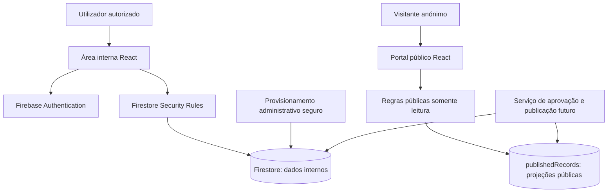

# Governo CCLX — Arquitetura da Solução

**Estado:** arquitetura-alvo proposta; não representa infraestrutura já publicada.

## 1. Princípios
1. **Governo institucional, não gestão operacional.**
2. **Separação entre identidade, autorização e competência institucional.**
3. **Segurança por defeito:** acesso negado salvo autorização expressa.
4. **Separação entre informação interna e informação pública.**
5. **Decisões e versões rastreáveis.**
6. **Evolução gradual**, começando no plano Firebase Spark.

## 2. Vista lógica

O diagrama é conceptual. **Não existe ligação direta permitida do portal público aos documentos internos.** O serviço de aprovação/publicação requer execução num ambiente confiável; não deve ser substituído por lógica privilegiada no browser.

## 3. Camadas
### Apresentação
React + TypeScript, navegação interna por módulos, portal público separado, formulários e vistas adaptadas às permissões. Ocultar controlos é apenas uma medida de interface, não de segurança.

### Identidade
Firebase Authentication por link de email. A sessão autenticada fornece o UID. O endereço de email não substitui o UID como identificador de autorização.

### Autorização
Firestore Security Rules e, para operações complexas, um serviço confiável futuro. As regras verificam utilizador ativo, âmbito, papel e classificação. Alterações de papéis não são permitidas ao cliente.

### Domínio
Entidades institucionais, Cultura Geral, Cultura Local, propostas, decisões, classificação, publicação e auditoria. As transições de estado e as competências devem ser validadas antes de persistir.

### Persistência
Firestore para registos internos, utilizadores, decisões e histórico; coleção pública separada para conteúdos autorizados. Esquemas e índices versionados.

### Operações privilegiadas
Provisionamento, aprovação com garantias de integridade, geração de projeções públicas e auditoria confiável exigem mecanismos executados fora do browser. **No Spark, operações não suportadas com segurança ficam indisponíveis**; Cloud Functions podem ser avaliadas numa fase posterior.

## 4. Fluxos principais
**Login:** link de email → Firebase Auth → UID → consulta de autorização → acesso permitido ou negado.

**Consulta interna:** utilizador autenticado → pedido Firestore → regras de autorização → dados dentro do âmbito.

**Decisão institucional:** proposta → apreciação competente → decisão registada → versão e auditoria.

**Publicação:** decisão institucional → revisão de classificação → autorização de publicação → projeção pública mínima → portal público. A autoridade de publicação permanece por definir.

## 5. Estratégia de evolução
- **Fase A — Especificação:** requisitos funcionais, técnicos e arquitetura; decisões pendentes identificadas.
- **Fase B — Fundação segura:** autenticação, autorização, esquema de dados, testes e provisionamento.
- **Fase C — Governo interno:** estrutura, cultura, documentos, propostas e decisões persistentes.
- **Fase D — Portal público:** autorização editorial, projeções seguras e publicação.
- **Fase E — Evolução:** automatizações, integrações e serviços privilegiados conforme necessidade e orçamento.

## 6. Decisões de arquitetura pendentes
- Serviço confiável para operações privilegiadas e sua infraestrutura.
- Contratos finais de dados, índices e estratégia de migração.
- Estratégia de auditoria imutável, retenção e recuperação.
- Endereços e ambientes de publicação.
- Modelo de autoridade de publicação e desclassificação.
